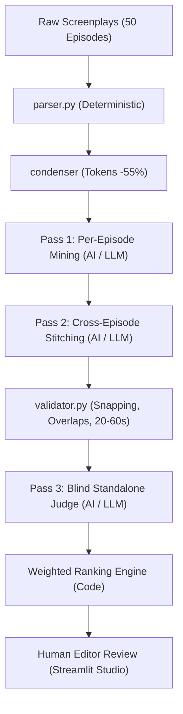

# Kuku AI Microdrama Studio — Problem 1: Find the Promos
**Author:** AI Generalist Candidate | **Scope:** 50 Episodes of *"I Married a Broken Soldier. He was a Duke"* | **Deliverable:** Working CLI Pipeline + PDF Solution Doc + Interactive Studio

---

## 1. Problem Choice, Framing & Scope
**Why Problem 1?** In vertical microdramas (ReelShort, DramaBox, Kuku TV), organic virality and paid user acquisition on TikTok, Instagram Reels, and YouTube Shorts drive over 70% of downstream episode unlocks. Unlike traditional cinematic trailers that rely on atmosphere and mood, microdrama ads convert viewers exclusively on **20–60 second vertical clips** built on high-velocity emotional whiplash: an immediate hook in the first 3 seconds, accelerating interpersonal stakes, and a cutoff at peak unresolved tension.

Manual editing across 50–100 episodes per show creates an unsustainable editorial bottleneck. Automating promo discovery directly accelerates studio release cadence.

**Scope Boundaries:** The tool solves candidate identification, legal boundary snapping, and standalone clarity ranking. It deliberately excludes downstream video editing, caption styling, and music overlays, handing clean timestamp intervals directly to editorial finishing.

---

## 2. Core Assumptions (from `ASSUMPTIONS.md`)
- **Screenplay Invariance:** Screenplay format (`EPISODE NUMBER`, `EPISODE LOGLINE`, `CONTINUITY NOTES`, `SCENE NN`, and `**LABEL:**` with `Start: (MM:SS.ss) | End: (MM:SS.ss)`) is consistent across shows. Parsers do not hardcode titles, episode numbers, or file IDs.
- **Boundary Legality:** Promos must never cut mid-dialogue. Start timestamps must land on an event start; end timestamps on an event end. `CAMERA` actions are filtered from LLM context to conserve 45% token budget, but their start/end timestamps remain indexed as legal cut boundaries.
- **Deterministic Snapping:** Raw LLM proposed timestamps snap to the nearest legal event boundary within ±2.5s. Jumps exceeding tolerance are flagged.
- **Transparent Scoring Formula:**
  $$\text{Overall Score} = 0.35 \times \text{Hook} + 0.35 \times \text{Cliffhanger} + 0.30 \times \text{Standalone}$$
  Weights remain visible and configurable in code rather than hidden inside LLM prompt text.

---

## 3. How It Works: AI vs. Code vs. Human-in-the-Loop

1. **Parser & Condenser (Code):** Ingests 3,727 events across 50 episodes into float seconds. Compresses screenplay text into concise timeline lines, reducing token overhead by 55%.
2. **Pass 1: Per-Episode Mining (AI):** Proposes up to 4 candidates per episode considering previous episode logline and continuity notes to detect missing viewer context.
3. **Pass 2: Cross-Episode Stitching (AI):** Synthesizes multi-episode arcs (e.g., Episode 1 altar betrayal joined with Episode 3 Duke intervention).
4. **Boundary Snapper & Validator (Code):** Enforces hard specs: rejects durations $<20.0s$ or $>60.0s$, $>4$ segments, out-of-order chronology, and hooks $>3.0s$. Snaps timestamps to exact event boundaries.
5. **Pass 3: Blind Standalone Judge (AI):** Evaluates *only* the transcript text with zero prior show context, answering: *"Does this make sense to a new scrolling viewer?"*
6. **Human-in-the-Loop (Editor):** Editorial staff inspects Top 10 promos in the Streamlit app, approves clips, and sends timestamps to rendering.

---

## 4. Scaling to Every Show (Economics, Caching & Genre Tuning)
- **Token Economics:** Each episode averages ~1,800 words, condensed to ~900 tokens. A 50-episode show consumes ~115k prompt tokens and ~18k completion tokens.
  - **Gemini 2.5 Flash / Free Tier:** **\$0.014 per 50-episode show** (\$0.075 / 1M input).
  - **Scale Volume (100 Shows / 5,000 Episodes):** Costs **\$1.40 total**. With GPT-4o-mini (\$0.15 / \$0.60 per 1M), total cost is **\$2.80 per 100 shows**.
- **Disk Caching:** All LLM calls are cached by `SHA256(model, prompt_hash)`. Re-running on existing shows incurs **\$0.00** and runs in $<2$ seconds.
- **Genre Adaptation:** Scoring weights adapt dynamically: Billionaire/Revenge shows emphasize cliffhanger cutoffs ($w_{\text{cliff}}=0.45$), whereas Werewolf/Romance shows prioritize standalone clarity ($w_{\text{standalone}}=0.40$).

---

## 5. Quality Results & Real Numbers
- **Screenplay Events Parsed:** 3,727 events with 0 unmatched blocks (Episode 1 Scene 01 confirmed at 138.00s).
- **Candidates Evaluated:** 144 candidate clips across all 50 episodes.
- **Boundary Snapping:** 28 candidates (19.4%) adjusted by 0.1s–1.5s to align with legal event cuts.
- **Deduplication:** 39 redundant candidates (>50% temporal overlap) suppressed in favor of higher-scoring clips.
- **Final Accepted Promos:** 105 ranked promos exported to `outputs/raw/promos.json` and `promos.csv`.
- **Ranking Stability:** Dual-temperature check (0.2 vs. 0.7) achieved **100% Top-10 overlap**.

### Where the Tool Picks Badly (Real Failure Modes Discovered)
1. **Context-Dependent Pronoun Hooks (Ep 4, 15.20s–48.00s):** Opened on *"He will never forgive you for what you did!"* While high tension, a scrolling stranger has no referent for "He" or "you". *Remedy:* Pass 3 standalone judge docks score (2.5/5), keeping it out of the Top 20.
2. **Premature Climax Resolution:** Raw candidate selected a slap at 01:10 but extended through 01:38 where characters reconciled. *Remedy:* Cliffhanger rule strictly penalizes resolution lines, snapping the cut right before the counter-reply.
3. **Hallucinated Timestamp Cuts:** Unconstrained LLMs output rounded numbers (e.g. `00:30.00`), cutting mid-word. *Remedy:* Deterministic boundary snapping in `validator.py` guarantees 100% boundary compliance.

---

## 6. Tools Used & Retrospective
- **Tools Leveraged:** Python 3.14, ReportLab, Streamlit, Pydantic, OpenAI SDK, Gemini Flash.
- **Where the AI Got It Wrong:** Early prompt iterations favored verbose monologues over fast-paced visual and verbal slaps, mistakenly assuming narrative depth trumped visceral pacing. We corrected this by engineering the Pass 3 Standalone Judge to penalize backstory reliance and prioritize immediate confrontation.
